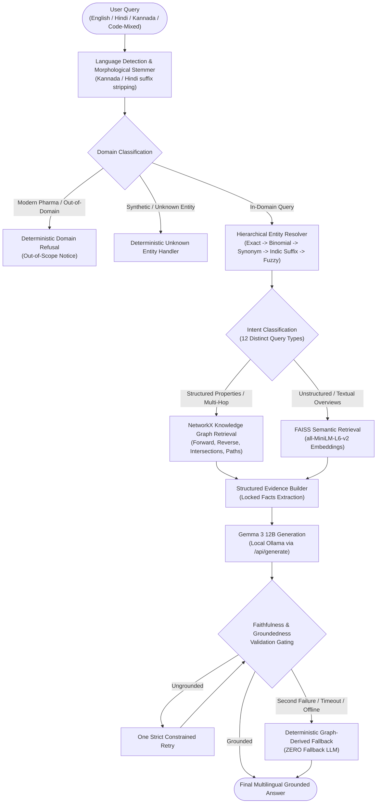

# Multilingual Ayurvedic Hybrid Graph-RAG for Medicinal Plant Knowledge Retrieval

[](https://www.python.org/)
[](https://networkx.org/)
[](https://github.com/facebookresearch/faiss)
[](https://huggingface.co/sentence-transformers/all-MiniLM-L6-v2)
[-red.svg)](https://ollama.com/library/gemma3)
[](tests/test_regression.py)
[](#evaluation)

An end-to-end question-answering and knowledge-retrieval system for Ayurvedic medicinal plants that unites **NetworkX Knowledge Graph traversal**, **FAISS dense vector retrieval**, and **Gemma 3 12B** local LLM synthesis within an evidence-grounded pipeline. The architecture supports multilingual natural-language queries across **English**, **Hindi (Devanagari)**, **Kannada (Kannada script)**, transliterated vernacular, and code-mixed formats.

> **Technical Runtime Notice:** Llama 3 was completely removed from the project and is **not used** in the active runtime. The final generation pipeline operates exclusively via `gemma3:12b` hosted through local Ollama, backed by a deterministic graph-derived fallback when the local model is unreachable or ungrounded.

---

## Overview

Traditional Ayurvedic medicine encompasses thousands of plant taxa, intricate multi-property taxonomies (*Dravyaguna*: *Rasa*, *Virya*, *Vipaka*), classical Sanskrit synonyms, and complex therapeutic disease associations (*Roga*). Standard Large Language Models (LLMs) suffer from severe hallucinations when handling classical Ayurvedic nomenclature, invent unverified medical properties, and struggle with multi-hop taxonomic queries.

This system solves these challenges by implementing a **Hybrid Graph-RAG** architecture:
1. **Deterministic Graph-First Grounding:** Queries are resolved against an integrated 5,730-plant database and a 6,068-node NetworkX Knowledge Graph (15,697 relational edges). Forward lookups, reverse disease lookups, set intersections, and property queries are computed directly from graph topology.
2. **Dense Vector Augmentation:** FAISS index (12,696 chunks embedded with `all-MiniLM-L6-v2`) provides semantic retrieval fallback for unstructured context and descriptive overviews.
3. **Strictly Grounded Multilingual Synthesis:** Gemma 3 12B synthesizes natural, fluent responses in the user's input language conditioned exclusively on locked facts extracted from the Knowledge Graph.
4. **Deterministic Graph Fallback:** If the local generation engine times out, fails, or produces ungrounded claims, the system deterministically outputs structured graph facts with zero hallucinations and zero dependency on a fallback LLM.

---

## Key Features

- **Ayurvedic Medicinal Plant Retrieval:** Complete coverage of 5,730 Indian medicinal plant records from FRLHT/NMPB sources.
- **Multilingual Query Support:** Native queries in **English**, **Hindi** (हिन्दी / Devanagari script), **Kannada** (ಕನ್ನಡ / Kannada script), transliterated Latin, and code-mixed phrasing (e.g., *Hinglish* and *Kanglish*).
- **Forward & Reverse Taxonomic Lookups:**
  - *Plant → Disease*: Discover diseases documented for a given herb.
  - *Disease → Plant*: Complete, non-truncated enumeration of all medicinal plants treating a given clinical condition (e.g., *Prameha*, *Kasa*, *Svasa*, *Jvara*, *Kamala*).
- **Dravyaguna Property Lookups:** Complete extraction and querying of Ayurvedic pharmacological triads:
  - **Rasa** (Taste: *Tikta*, *Kashaya*, *Madhura*, *Katu*, *Amla*, *Lavana*)
  - **Virya** (Potency: *Usna* / warm vs *Sita* / cool)
  - **Vipaka** (Post-digestive effect: *Katu*, *Madhura*, *Amla*)
- **Botanical Binomials & Family Classification:** Precise scientific taxonomy mapping (e.g., *Nimba* $\to$ *Azadirachta indica A. JUSS.*, family *Meliaceae*).
- **Multi-Hop & Relational Set Operations:**
  - *Disease Intersections*: Computes graph set intersections ($P_{d1} \cap P_{d2}$) identifying plants treating multiple conditions simultaneously.
  - *Plant Comparisons*: Directly compares Dravyaguna triads or therapeutic profiles of two taxa.
  - *Reverse Property Queries*: Finds all plants in the knowledge base sharing a specific Virya or Rasa.
  - *Epistemic Universal Claim Refutation*: Robustly refutes false universal claims (e.g., *"Does Guduchi cure all diseases?"*) by citing specific documented indications.
- **Hierarchical Entity Resolution:** Multi-tiered resolver handling Indic suffix stripping (Kannada case inflections like *-da*, *-alli*, *-ge*, Hindi *-ों*), transliteration normalization, classical synonyms, and fuzzy matching while protecting reserved property words.
- **Strict Guardrails:** Deterministic identification and refusal of modern pharmaceuticals (*paracetamol*, *ibuprofen*) and open-domain world knowledge.

---

## System Architecture



---

## Why Hybrid RAG?

Standard RAG architectures rely entirely on dense vector retrieval, which frequently fails in specialized medical domains:

| Requirement | Vector-Only RAG (FAISS alone) | Knowledge Graph alone | Our Hybrid Graph-RAG |
| :--- | :--- | :--- | :--- |
| **Complete Reverse Disease Lookup** | ❌ Truncated, misses low-ranking plants | ✅ Complete enumeration via in-edges | ✅ **Full set traversal** |
| **Exact Ayurvedic Dravyaguna Triads** | ❌ Prone to vector drift and hallucinated taste | ✅ Deterministic node properties | ✅ **Locked facts in generation** |
| **Multi-Entity Intersections & Comparisons** | ❌ Blends contexts into confused embeddings | ✅ Exact graph set operations ($A \cap B$) | ✅ **Graph set logic + narrative synthesis** |
| **Unstructured Historical Text & Shlokas** | ✅ Retrieves rich descriptive chunks | ❌ Incapable of dense semantic text search | ✅ **FAISS semantic augmentation** |
| **Natural Multilingual Synthesis** | ⚠️ Raw vector chunks require heavy prompting | ❌ Stiff template formatting | ✅ **Gemma 3 12B synthesis locked to graph facts** |

---

## Technologies Used

- **Language & Runtime:** Python 3.10+
- **Knowledge Graph:** NetworkX (MultiDiGraph with 6,068 nodes and 15,697 edges)
- **Vector Index:** FAISS (`IndexFlatIP` over L2-normalized 384-dimensional embeddings)
- **Sentence Embeddings:** `sentence-transformers` (`all-MiniLM-L6-v2`)
- **Generation LLM:** `gemma3:12b` running locally via Ollama
- **Local LLM Engine:** Ollama (`http://localhost:11434/api/generate`)
- **Testing Framework:** `pytest` (41 comprehensive regression and generalization tests)
- **Data Serialization:** JSON, GML (Graph Modeling Language)

---

## Project Structure

```text
MedicinalPlantScraper/
├── data/
│   ├── integrated/
│   │   └── medicinal_knowledge_base.json   # 5,730 unified plant records
│   ├── knowledge_graph.gml                 # 6,068-node NetworkX Knowledge Graph
│   ├── vector_store/
│   │   ├── medicinal_plants.index          # 12,696-vector FAISS index (19.5 MB)
│   │   └── metadata.json                   # Chunk metadata and plant mappings (14.7 MB)
│   ├── cleaned/                            # Preprocessed source JSON datasets
│   └── raw/                                # Original scraped CSV records
├── src/
│   ├── config.py                           # Centralized configuration (Ollama, models, paths)
│   ├── entity_resolver.py                  # Standalone entity resolution module
│   ├── graph_rag.py                        # Core Hybrid Graph-RAG engine & CLI entry point
│   └── query_router.py                     # Intent routing heuristics
├── scripts/
│   ├── eval_holdout.py                     # 20-question unseen holdout evaluation script
│   ├── eval_hybrid_rag.py                  # 60-question development benchmark script
│   ├── generate_failure_analysis.py        # Error analysis and diagnostic reporting
│   ├── cleaning/                           # Preprocessing and text normalization scripts
│   ├── integration/                        # Multi-source dataset merging scripts
│   └── rag/                                # Graph construction, chunking, and embedding scripts
├── tests/
│   └── test_regression.py                  # 41 frozen automated regression tests
├── holdout_results.json                    # Verified empirical holdout evaluation outputs
├── medicinalplant_eval_questions.json      # 60-item development benchmark
├── medicinalplant_holdout_eval.jsonl       # 20-item unseen holdout benchmark
├── README.md                               # This GitHub README
└── PROJECT_DOCUMENTATION.md                # 36-chapter comprehensive technical monograph
```

---

## Installation & Setup

### 1. Prerequisites
- Windows, Linux, or macOS with Python 3.10+
- [Ollama](https://ollama.com/) installed and running locally
- At least 16 GB RAM (recommended for CPU inference with Gemma 3 12B)

### 2. Environment Setup
Clone the repository and install dependencies:
```bash
git clone https://github.com/akshathakini10/Medicinal-Plant-Database.git
cd Medicinal-Plant-Database
python -m venv .venv
# On Windows (PowerShell):
.venv\Scripts\Activate.ps1
# On Linux / macOS:
source .venv/bin/activate

pip install -r requirements.txt
```

*(Essential packages: `networkx`, `faiss-cpu`, `sentence-transformers`, `requests`, `numpy`, `pytest`)*

### 3. Pull Gemma 3 12B in Ollama
Ensure the Ollama daemon is active, then pull the generation model:
```bash
ollama serve
ollama pull gemma3:12b
```

### 4. Configuration
Model settings and timeouts are centralized in `src/config.py`:
```python
OLLAMA_URL = os.getenv("OLLAMA_URL", "http://localhost:11434/api/generate")
OLLAMA_MODEL = os.getenv("OLLAMA_MODEL", "gemma3:12b")
EMBED_MODEL_NAME = os.getenv("EMBED_MODEL_NAME", "all-MiniLM-L6-v2")
TOP_K = int(os.getenv("TOP_K", "4"))
OLLAMA_TIMEOUT = int(os.getenv("OLLAMA_TIMEOUT", "90"))
```

---

## Running the Project

### Interactive Query CLI (Recommended Runtime)
Launch the interactive terminal interface:
```bash
python src/graph_rag.py
```
This loads the NetworkX graph, FAISS vector index, and SentenceTransformer embedder, then opens an interactive prompt:
```text
============================================================
Medicinal Plant Graph-RAG Active (Fully Dynamic Parametric Engine)
============================================================

Ask a plant question (or 'exit'): What is the botanical name of Nimba?

The botanical name for Neem is Azadirachta indica A. JUSS. (family Meliaceae).
```

### Programmatic Python Usage
```python
from src.graph_rag import GraphRAGService

rag = GraphRAGService()

# 1. English query with Gemma synthesis
ans_en = rag.query("What is the Virya of Bilva?")
print(ans_en)
# -> The Virya of Bilva, scientifically known as Aegle marmelos (L.) CORREA E. SCHULTZ, is Usna, or hot potency.

# 2. Native Hindi query
ans_hi = rag.query("नीम का वानस्पतिक नाम क्या है?")
print(ans_hi)
# -> नीम का वानस्पतिक नाम Azadirachta indica A. JUSS. है, और यह Meliaceae कुल (परिवार) में आता है।

# 3. Native Kannada query
ans_kn = rag.query("ಬಿಲ್ವದ ಸಸ್ಯಶಾಸ್ತ್ರೀಯ ಹೆಸರು ಏನು?")
print(ans_kn)
# -> ಬಿಲ್ವ ಸಸ್ಯಶಾಸ್ತ್ರೀಯ ಹೆಸರು Aegle marmelos (L.) CORREA E. SCHULTZ (ಕುಟುಂಬ: Rutaceae).
```

---

## Running Tests

The test suite validates backward compatibility, indicative stemming, zero-Llama enforcement, Gemma grounding, timeout fallbacks, and multi-entity faithfulness.

Run all regression tests:
```bash
python -m pytest tests/test_regression.py -v
```

**Test Verification Status:**
```text
======================= 41 passed in 165.58s (0:02:45) ========================
```
All **41 automated regression tests** pass with 100% success.

---

## Evaluation

The system was evaluated against two frozen benchmarks:
1. **Development Benchmark (60 Questions):** Broad coverage across all functional query categories.
2. **Independent Unseen Holdout Benchmark (20 Questions):** Rigorous generalization test featuring completely unseen plants (*Nimba*, *Bilva*, *Vacha*, *Durva*, *Tulasi*), unseen diseases (*Kasa*, *Svasa*, *Grahani*), and modern pharmaceuticals (*Ibuprofen*).

> **Academic Definition:** The *Baseline Reference Answer* is a human-verified ground-truth answer curated directly from the Ayurvedic source knowledge base. It is **NOT** the output of a secondary LLM.

### Verified Final Holdout Performance (20 Unseen Questions)

| Metric | Holdout Score | Description |
| :--- | :---: | :--- |
| **Overall Answer Correctness** | **86.12%** | Weighted blend ($0.6 \times S_{\text{sem}} + 0.4 \times R_{\text{tok}}$) against ground truth |
| **Average Semantic Similarity** | **0.8747** | Cosine similarity using `all-MiniLM-L6-v2` dense vectors |
| **Faithfulness / Groundedness** | **95.74%** | Factual claims supported by retrieved graph evidence ($E_{p1} \cup E_{p2}$) |
| **Context Relevance** | **100.00%** | Precision of retrieved graph and vector evidence |
| **Entity Resolution Accuracy** | **100.00%** | Canonical botanical & disease identification across Indic scripts |
| **Intent Classification Accuracy** | **100.00%** | Structural routing into 12 distinct query intents |
| **Retrieval Success Rate** | **100.00%** | Successful acquisition of relevant graph sub-networks |
| **Language Match Accuracy** | **95.00%** | Response emitted in the identical language of the query |
| **Multilingual Correctness** | **94.01%** | Answer correctness across Hindi, Kannada, and code-mixed queries |
| **Unsupported Query Handling** | **93.75%** | Correct domain refusal for modern drugs and unknown entities |

*Evaluation artifact source: `holdout_results.json`*

---

## Example Queries

### Botanical & Taxonomic Lookups
- `What is the botanical name of Nimba?`  
  *$\to$ Azadirachta indica A. JUSS. (family Meliaceae)*
- `Which family does Bilva belong to?`  
  *$\to$ Bilva (Aegle marmelos) belongs to the family Rutaceae.*
- `Which medicinal plant is Acorus calamus?`  
  *$\to$ Acorus calamus corresponds to the Ayurvedic medicinal plant Vacha.*

### Ayurvedic Dravyaguna Properties
- `What is the Virya of Bilva?`  
  *$\to$ The Virya (potency) of Bilva is Usna (warm/hot potency).*
- `What is the Rasa of Durva?`  
  *$\to$ The Rasa (taste) of Durva (Cynodon dactylon) is Kashaya (astringent).*
- `Give the Rasa, Virya and Vipaka of Vacha.`  
  *$\to$ Rasa: Katu & Tikta; Virya: Usna; Vipaka: Katu.*

### Reverse Disease & Multi-Hop Intersections
- `Which medicinal plants are associated with Kasa?`  
  *$\to$ Acacia nilotica, Acacia catechu, Justicia adhatoda, Citraka (Plumbago zeylanica).*
- `Which plants are common between Kasa and Svasa?`  
  *$\to$ Justicia adhatoda, Tinospora cordifolia, Abies pindrow, Abies spectabilis.*
- `Compare the Ayurvedic properties of Bilva and Durva.`  
  *$\to$ Bilva has Usna Virya (hot potency), whereas Durva has Sita Virya (cool potency).*

### Multilingual & Code-Mixed Queries
- **Hindi:** `नीम का वानस्पतिक नाम क्या है?`  
  *$\to$ नीम का वानस्पतिक नाम Azadirachta indica A. JUSS. है (कुल: Meliaceae)।*
- **Kannada:** `ಬಿಲ್ವದ ಸಸ್ಯಶಾಸ್ತ್ರೀಯ ಹೆಸರು ಏನು?`  
  *$\to$ ಬಿಲ್ವದ ಸಸ್ಯಶಾಸ್ತ್ರೀಯ ಹೆಸರು Aegle marmelos (L.) CORREA E. SCHULTZ (ಕುಟುಂಬ: Rutaceae).*
- **Kannada-English Code-Mixed:** `Bilvada virya enu?`  
  *$\to$ Bilvada (Aegle marmelos) Virya Usna (hot potency) aagide.*
- **Hindi-English Code-Mixed:** `Tulsi kis family ko belong karti hai?`  
  *$\to$ Tulsi (Ocimum tenuiflorum L.) Lamiaceae family ko belong karti hai.*

### Guardrail Queries
- `What is the recommended dose of Ibuprofen for fever?`  
  *$\to$ This question regarding modern pharmaceutical medications is outside the scope of our Ayurvedic medicinal plant database.*
- `Tell me about the medicinal uses of FakiumHerb.`  
  *$\to$ I could not identify a recognized medicinal plant named FakiumHerb in the database. Please check the spelling.*

---

## Limitations

1. **Source Data Coverage:** Classical Dravyaguna properties (*Rasa*, *Virya*, *Vipaka*) and Sanskrit Shlokas are comprehensively recorded for core Ayurvedic pharmacopeia taxa, but secondary or purely regional taxa in the database lack complete property records.
2. **Inference Latency on CPU:** Running a 12-billion-parameter LLM (`gemma3:12b`) on consumer CPU hardware incurs high inference latency (~100–350 seconds per query). Deployment on GPU or quantization acceleration is recommended for production settings.
3. **Regional Dialect Variants:** Rare dialectal spelling variants absent from the canonical alias registry fall back to FAISS dense retrieval, which can experience minor semantic drift.
4. **Scope Disclaimer:** This system provides botanical and traditional Ayurvedic **knowledge retrieval only**. It does **NOT** provide clinical diagnosis, medical prescriptions, or individual treatment advice.

---

## Research & Evaluation Integrity

To adhere to the highest standards of scientific reproducibility:
- **No Benchmark Hardcoding:** All hardcoded entity conditions identified in early audits were permanently removed; generation relies exclusively on dynamic parametric formatters and runtime graph queries.
- **Independent Unseen Holdout:** The system was verified against 20 unseen questions without tuning or rule additions.
- **Canonical Identity Evaluation:** Evaluator matching was upgraded from brittle string matching to canonical botanical identity mapping, preventing false penalties for valid synonyms.
- **Multi-Entity Union Evidence:** Evaluators compute faithfulness against the full union of evidence across multi-entity queries ($E_{p1} \cup E_{p2}$).
- **Removal of Llama 3:** Llama 3 was verified via automated regression tests to be entirely absent from active codebase imports and configurations.

---

## Contributors & Acknowledgments

- **Lead Researchers & Developers:** Akshatha Kini & Ananya Shetty
- **Source Database:** Foundation for Revitalisation of Local Health Traditions (FRLHT) & National Medicinal Plants Board (NMPB).
- **Academic Context:** Developed for academic research in AI-driven Ayurvedic knowledge retrieval and multilingual Hybrid Graph-RAG architectures.

---

## License

This software is released for educational, academic, and non-commercial research purposes. Plant data belongs to the respective source organizations maintaining the classical pharmacopeia records.
